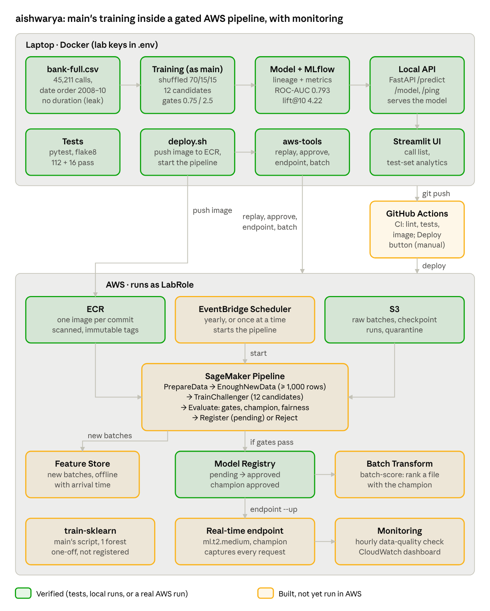
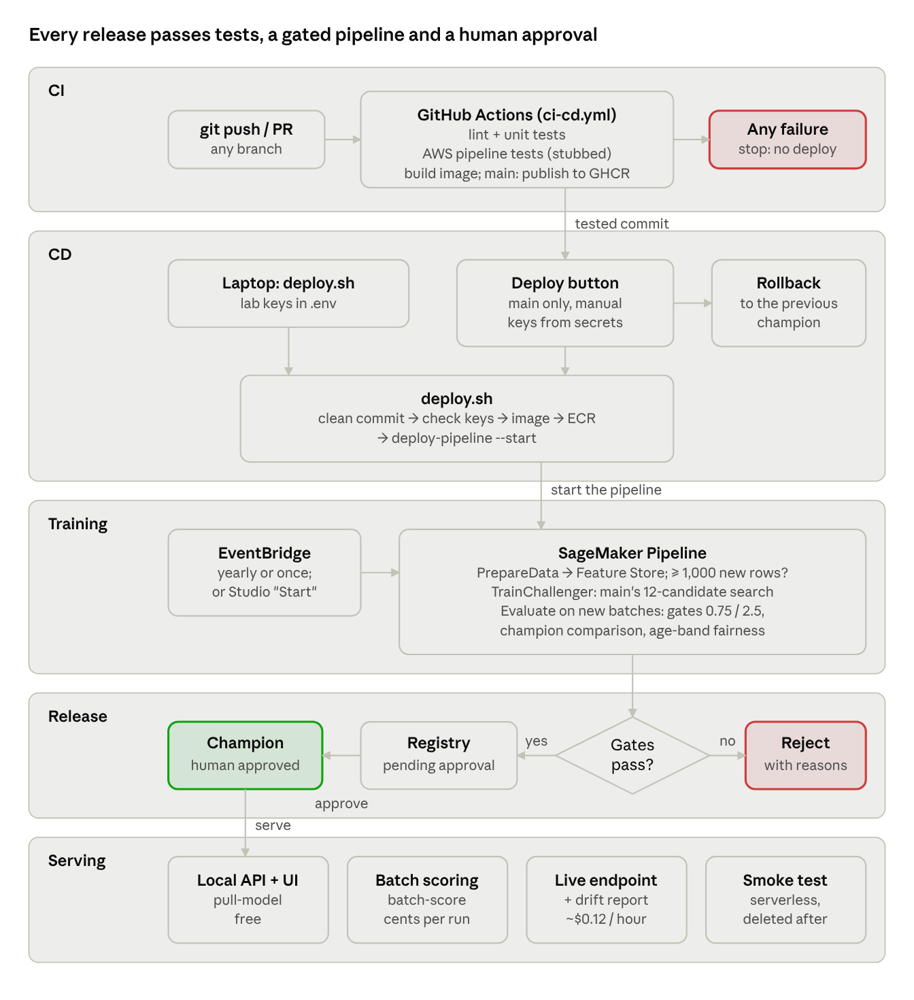

# Term Deposit Prediction: an MLOps System

**AAI-540 Group 5:** Dhrub Satyam, Anugrah Rastogi, Aishwarya Gulhane
**Repository:** https://github.com/anugrah-sandiego/AAI-540-Project-Group-5

A bank phones customers to sell term deposits, and only 11.7% say yes. This project
ranks customers by how likely they are to subscribe, so the call centre phones the
most promising ones first. On customers the model never saw, calling the top 10% of
the list reaches **49.3% subscribers instead of 11.7% (4.2x better than random calling)**.

The same code runs in two places:

- **Locally, free:** open-source stack (scikit-learn, MLflow, FastAPI, Streamlit) in Docker.
- **In AWS SageMaker:** a pipeline that retrains as new data arrives and promotes a model
  only after it passes four checks and a person approves it.



---

## Contents

1. [Quick start (local, about 15 minutes)](#quick-start-local)
2. [Run it in AWS](#run-it-in-aws)
3. [How it works](#how-it-works)
4. [Project structure](#project-structure)
5. [Data](#data)
6. [Model and results](#model-and-results)
7. [CI/CD](#cicd)
8. [Configuration](#configuration)
9. [Troubleshooting](#troubleshooting)
10. [Future improvements](#future-improvements)
11. [References](#references)

---

## Quick start (local)

Everything runs in Docker, so you do not need to install Python or any packages.

### 1. Install the tools

- [Docker Desktop](https://www.docker.com/products/docker-desktop/), started and running
- [Git](https://git-scm.com/downloads) (on Windows, Git for Windows also gives you Git Bash)

### 2. Get the code

```bash
git clone https://github.com/anugrah-sandiego/AAI-540-Project-Group-5.git
cd AAI-540-Project-Group-5
git checkout aishwarya
```

### 3. Build the images (first time, a few minutes)

```bash
docker compose build
```

### 4. Run the tests

```bash
docker compose run --rm test
```

All tests should pass. This also confirms Docker works.

### 5. Train the model

```bash
docker compose run --rm train
```

This takes several minutes. It compares 12 candidate models, tunes the best one, checks
it against the quality gates and saves it to `models/`. It also writes the
train, validation and test splits to `data/processed/`.

> Training refuses to run from uncommitted code, so every model can be traced to a git
> commit. To experiment with uncommitted changes, add `-e ALLOW_DIRTY=1`:
> `docker compose run --rm -e ALLOW_DIRTY=1 train`

### 6. Open the dashboard

```bash
docker compose up ui
```

Open http://localhost:8501. This also starts the prediction API on port 8080. Stop both with `Ctrl+C`.

| Tab | What you see |
|---|---|
| Who to call | A slider for "call the top X%", the ranked call list with customer IDs, a CSV download, and a form to check one potential customer |
| Test data analytics | Subscriber rate by month and by segment (previous outcome, housing loan, contact type, age band, job) |
| Model performance | ROC-AUC, lift, gains curve, and actual vs predicted by month and by tenth of the list |

The sidebar switches the scores between the **local model** and the **AWS model** (the
SageMaker endpoint; see [Run it in AWS](#run-it-in-aws)). Every figure uses only the held-out
test split (6,782 customers the model never trained on).

### 7. Optional: other local tools

```bash
docker compose up api        # prediction API only: http://localhost:8080/docs
docker compose up mlflow     # MLflow experiment tracking: http://localhost:5000
docker compose run --rm shell   # a shell inside the container
```

Example prediction request:

```bash
curl -X POST http://localhost:8080/predict -H "Content-Type: application/json" -d '{"instances": [{"age": 35, "job": "management", "marital": "married", "education": "tertiary", "default": "no", "balance": 1200, "housing": "no", "loan": "no", "contact": "cellular", "day": 15, "month": "may", "campaign": 1, "pdays": -1, "previous": 0, "poutcome": "unknown"}]}'
```

---

## Run it in AWS

The AWS part was built for an **AWS Academy Learner Lab**. The full runbook, the S3
layout and the lab's limits are in [docs/aws.md](docs/aws.md); this section covers the main path.

### 1. Put the lab keys in `.env`

1. Start the lab and wait for the green dot.
2. Open **AWS Details**, then next to **AWS CLI** click **Show**.
3. Create a file named `.env` in the project root with:

```
AWS_ACCESS_KEY_ID=...
AWS_SECRET_ACCESS_KEY=...
AWS_SESSION_TOKEN=...
AWS_REGION=us-east-1
```

`.env` is git-ignored: never commit or share it. The keys expire after about 4 hours, so
repeat these steps when commands start failing with `ExpiredToken`.

### 2. Check access and upload data

```bash
docker compose run --rm aws-tools check                 # who am I; can the scheduler use LabRole?
docker compose run --rm aws-tools replay --batches 4    # history + 3 daily batches to S3
```

The dataset has no live feed, so `replay` simulates one. Batch `b0000` is the history
(the first 31,500 rows, in date order). Each later batch is 350 rows and stands for one day of new calls.

### 3. Deploy and run the training pipeline

Run this from Git Bash on Windows, or any terminal on Mac or Linux. Commit your changes first.

```bash
scripts/deploy.sh
```

It builds this commit's Docker image and pushes it to ECR. It then creates or updates the
SageMaker pipeline `bank-marketing-retrain` and starts a run. Watch the run in
**SageMaker Studio > Pipelines**; it takes about 15 to 25 minutes.

### 4. Approve, serve and monitor

```bash
docker compose run --rm aws-tools approve           # newest pending model becomes the champion
docker compose run --rm aws-tools batch-score       # score the test split with Batch Transform
docker compose run --rm aws-tools endpoint --up     # real-time endpoint + data capture + CloudWatch dashboard
docker compose run --rm aws-tools drift-report      # compare captured requests with training data (PSI)
docker compose run --rm aws-tools endpoint --down   # ALWAYS run this when finished
```

While the endpoint is up, choose **AWS model** in the dashboard's sidebar to see its scores.

### 5. Next runs

```bash
docker compose run --rm aws-tools replay --batches 3                      # the next "days" of data
docker compose run --rm aws-tools deploy-pipeline --image-tag <commit> --start   # run now
docker compose run --rm aws-tools schedule --once 2026-10-20T10:00:00     # or schedule one run
docker compose run --rm aws-tools rollback                                # restore the previous champion
docker compose run --rm aws-tools --help                                  # every command
```

### Cost

| What | Cost |
|---|---|
| Pipeline run, Batch Transform, `train-sklearn` | A few cents each; nothing is left running |
| Real-time endpoint (`ml.m5.large`) | About $0.12 per hour, $2.80 per day, until `endpoint --down` |
| S3, ECR, Feature Store storage | Cents per month |

---

## How it works

### Local training (`src/pipelines/training_pipeline.py`)

1. Load `bank-full.csv` and validate it: columns, types, nulls, labels, duplicates and "unknown" rates.
2. Drop `duration`, the call length, because it is only known after the call.
3. Make a stratified, shuffled 70/15/15 split into train, validation and test.
4. Compare 12 candidates with 5-fold cross-validation, ranked by PR-AUC: 4 models
   (logistic regression, decision tree, random forest, gradient boosting) × 3 ways of
   handling the rare class (none, class weights, SMOTE).
5. Tune the best candidate (20 random-search iterations).
6. Choose the decision cut-off on the validation split.
7. Evaluate once on the test split. The run fails unless ROC-AUC ≥ 0.75 and lift in the top 10% ≥ 2.5.
8. Log everything to MLflow. Save `models/model.joblib` and `model_metadata.json`
   with the commit, branch and data hash.

### Continuous training in AWS (`src/aws/pipeline.py`)

Every pipeline run retrains from scratch on a growing window of data and is judged on
data that arrived later. Runs are started by hand or by EventBridge Scheduler.

1. **PrepareData** validates every batch and quarantines bad ones. Batches seen before become
   training data; batches new in this run become evaluation data. It also writes new batches
   to the Feature Store.
2. **EnoughNewData** stops the run unless at least 1,000 new rows have arrived.
3. **TrainChallenger** runs the same training as locally, then refits on all the history.
4. **EvaluateChallenger** scores the challenger and the current champion on the new data.
   The challenger must pass all four checks:
    - ROC-AUC ≥ 0.75
    - lift@10 ≥ 2.5
    - PR-AUC no more than 0.01 below the champion's
    - recall in every age band at least 80% of overall recall
5. **RegisterChallenger** registers it as *pending approval*, or **RejectChallenger** fails
   the run with the reasons. Nothing is served until a person runs `aws-tools approve`.

The newest customers subscribe far more often than the history, so cloud runs score lower than
the local shuffled test. The last full run (October 2026) was rejected on all four checks
(ROC-AUC 0.633). The checks did their job: a weaker model never reached production.

### Serving (`src/serving/app.py`)

One FastAPI app serves both local clients and SageMaker:

| Route | Purpose |
|---|---|
| `GET /ping` | Health check |
| `POST /predict`, `POST /invocations` | Probabilities for a list of customers (SageMaker calls `/invocations`) |
| `GET /model` | Which model is serving: type, cut-off, test metrics, commit, data hash |

The model accepts raw columns; all preprocessing is inside the saved scikit-learn pipeline.

---

## Project structure

```
AAI-540-Project-Group-5/
├── config.yaml                  # data split, models, tuning, quality gates, MLflow
├── data/raw/                    # bank-full.csv (45,211 rows), bank.csv (10% sample), bank-names.txt
├── data/processed/              # train / val / test Parquet splits (generated)
├── models/                      # model.joblib + model_metadata.json (generated)
├── notebooks/                   # EDA, model development and evaluation notebooks
├── src/
│   ├── data_ingestion/          # load and validate data, split
│   ├── data_preprocessing/      # target encoding, scaler + one-hot encoder
│   ├── feature_engineering/     # domain features (previously_contacted, prior_success, ...)
│   ├── models/                  # build, compare, tune (train_model.py); predict, evaluate, lift (predict_model.py)
│   ├── pipelines/               # training_pipeline.py: the end-to-end local training run
│   ├── serving/app.py           # FastAPI prediction service (local and SageMaker)
│   ├── ui/                      # Streamlit dashboard (app.py) and its calculations (analysis.py)
│   ├── utils/                   # config loading, logging, model lineage
│   └── aws/
│       ├── cli.py               # aws-tools: every AWS command
│       ├── config.py            # names of the bucket, pipeline, registry, endpoint
│       ├── pipeline.py          # SageMaker pipeline definition
│       ├── steps/               # prepare.py, train.py, evaluate.py: the pipeline's jobs
│       ├── registry.py          # champion lookup in the Model Registry
│       ├── feature_store.py     # Feature Store group and batch writes
│       ├── endpoint.py          # real-time endpoint, data capture, CloudWatch dashboard
│       ├── drift.py             # PSI drift report on captured requests
│       ├── batch.py             # Batch Transform scoring
│       └── sklearn_training.py, sklearn/   # training in AWS's scikit-learn container
├── tests/                       # pytest suite; tests/aws needs the SageMaker SDK
├── docker/                      # train / serve entry scripts for SageMaker
├── scripts/deploy.sh            # push this commit's image to ECR and start the pipeline
├── docs/                        # aws.md runbook, architecture.png, cicd-flow.png
├── .github/workflows/           # ci-cd.yml (CI), deploy.yml (manual Deploy to AWS button)
├── Dockerfile                   # images: dev, aws (aws-tools), ui, runtime (SageMaker)
├── docker-compose.yml           # services: test, train, mlflow, shell, api, ui, aws-tools, aws-test
└── requirements*.txt, constraints.txt   # dependencies and exact tested versions
```

---

## Data

[UCI Bank Marketing](https://archive.ics.uci.edu/dataset/222/bank+marketing): 45,211 phone
calls by a Portuguese bank, May 2008 to November 2010. It has 16 inputs and the label `y`
(subscribed, yes or no).

| Feature | Type | Description |
|---|---|---|
| age | numeric | Age of the client |
| job | categorical | Type of job (admin, technician, services, ...) |
| marital | categorical | Marital status |
| education | categorical | primary, secondary, tertiary, unknown |
| default | categorical | Has credit in default? |
| balance | numeric | Average yearly balance in euros |
| housing, loan | categorical | Has a housing loan / personal loan? |
| contact | categorical | Contact type (cellular, telephone, unknown) |
| day, month | numeric, categorical | Day and month of the last contact (no year) |
| duration | numeric | Call length in seconds; **excluded**, only known after the call |
| campaign | numeric | Contacts during this campaign |
| pdays | numeric | Days since the last contact in a previous campaign (-1 = never) |
| previous | numeric | Contacts before this campaign |
| poutcome | categorical | Outcome of the previous campaign |
| y | target | Subscribed to a term deposit? |

- **Imbalanced:** 5,289 yes (11.7%) and 39,922 no.
- **In date order, with drift:** the subscription rate climbs from about 3% in the first fifth
  of the file to about 32% in the last fifth. Local splits are shuffled; AWS evaluates on later batches.
- **"unknown" values:** kept as their own category (poutcome 82%, contact 29%, education 4%).
- **No personal data:** no names or phone numbers. The dashboard gives test customers generated IDs (`TEST-00001`).

---

## Model and results

Selected model: a random forest with no resampling and a tuned cut-off of 0.169
(`n_estimators` 314, `max_depth` 16, `min_samples_leaf` 8, `max_features` 0.5).

**Test split (6,782 customers):**

| Metric | Value |
|---|---|
| ROC-AUC | 0.793 |
| PR-AUC | 0.440 |
| F1 / precision / recall at the tuned cut-off | 0.477 / 0.432 / 0.532 |

| Customers called | Conversion | Lift vs random (11.7%) |
|---|---|---|
| Top 10% | 49.3% | 4.22x |
| Top 20% | 35.4% | 3.03x |
| Top 30% | 26.8% | 2.29x |

**Cross-validation on the training split** (mean of 5 folds; F1 at the default 0.5 cut-off):

| Model | Strategy | ROC-AUC | PR-AUC | F1 |
|---|---|---|---|---|
| Random forest | none | **0.791** | **0.445** | 0.290 |
| Gradient boosting | class weights | 0.794 | 0.442 | 0.455 |
| Random forest | class weights | 0.790 | 0.438 | 0.471 |
| Random forest | SMOTE | 0.783 | 0.419 | 0.439 |
| Logistic regression | class weights | 0.766 | 0.406 | 0.378 |
| Decision tree | class weights | 0.754 | 0.354 | 0.415 |

Class weights and SMOTE raise F1 at 0.5 but do not improve ranking (ROC-AUC, PR-AUC). The chosen
model therefore uses no resampling and gets the same F1 gain from a tuned cut-off.

**Why these metrics:** the bank calls a fixed number of customers, so ranking matters. Accuracy is
not used, because an all-"no" model already scores 88%.

---

## CI/CD



| Workflow | Trigger | What it does |
|---|---|---|
| CI (`.github/workflows/ci-cd.yml`) | Every push and pull request | Lint, all tests with coverage, aws-tools tests, runtime image build (pushed to GHCR from `main`) |
| Deploy to AWS (`.github/workflows/deploy.yml`) | Manual button, `main` only | Runs `scripts/deploy.sh`, or rolls back the champion |
| SageMaker pipeline | `deploy.sh`, `--start` or the scheduler | Continuous training: train, check, register for approval |

**Using the Deploy button:**

1. The workflow must be on `main`; GitHub shows manual buttons only for workflows on the default branch.
2. In **Settings > Secrets and variables > Actions**, add the repository secrets
   `AWS_ACCESS_KEY_ID`, `AWS_SECRET_ACCESS_KEY` and `AWS_SESSION_TOKEN` with fresh lab keys.
3. In **Actions > Deploy to AWS > Run workflow**, pick `deploy` or `rollback`.

Lab keys expire after about 4 hours, so update the secrets before each use. A real AWS account would use GitHub OIDC instead of stored keys.

---

## Configuration

`config.yaml` controls the split, excluded features, candidate models, imbalance strategies, tuning
budget, cut-off metric, quality gates and MLflow settings.

Environment variables (all optional except the AWS keys for AWS commands; put them in `.env`):

| Variable | Used by | Purpose |
|---|---|---|
| `AWS_ACCESS_KEY_ID`, `AWS_SECRET_ACCESS_KEY`, `AWS_SESSION_TOKEN`, `AWS_REGION` | aws-tools, dashboard (AWS source) | Temporary AWS Academy keys |
| `AWS_ROLE_ARN`, `AWS_BUCKET` | aws-tools | Override the default `LabRole` and SageMaker bucket |
| `ALLOW_DIRTY` | training | `1` to train from uncommitted code |
| `LOG_LEVEL`, `LOG_FORMAT` | all entry points | Log detail; `text` or `json` |
| `MLFLOW_TRACKING_URI` | training | Overrides the MLflow store |
| `MODEL_DIR` | API | Folder with `model.joblib` and `model_metadata.json` |

---

## Troubleshooting

| Problem | Fix |
|---|---|
| Training fails with `UncommittedCodeError` | Commit your changes, or add `-e ALLOW_DIRTY=1` for an experiment |
| Dashboard: "No test split" | Train first: `docker compose run --rm train` |
| Dashboard: "Local model is not answering" | Start the API: `docker compose up api` (or `docker compose up ui`, which starts both) |
| Dashboard: "AWS model is not answering" | Run `aws-tools endpoint --up` and check the keys in `.env` |
| `ExpiredToken` or `InvalidClientTokenId` | Lab keys expired: copy fresh ones from AWS Details into `.env` |
| `Refusing to deploy: commit your changes first` | Commit first; every image is tagged with its commit |
| Pipeline stops at **EnoughNewData** | Fewer than 1,000 new rows: `aws-tools replay --batches 3`, then start again |
| Pipeline ends at **RejectChallenger** | The model failed a check; the reasons are in `runs/<execution id>/evaluation/evaluation.json` in S3 |
| Endpoint: `AccessDenied` for the instance type | The lab denies `ml.t2.medium`; the default `ml.m5.large` works |
| Code change not visible in the dashboard | Restart it: `docker compose restart ui` |
| Tests outside Docker fail to import `src` | Run them in Docker: `docker compose run --rm test` |

---

## Future improvements

- **Time-aware training:** order splits by time inside each run too, and add features for the current period, so models keep up with the drift.
- **Training from the Feature Store:** build each run's training set from the offline store with Athena.
- **Calibration:** recalibrate probabilities on the newest batches.
- **More data:** `bank-additional-full.csv` adds economic indicators (such as the Euribor rate) that explain much of the drift.
- **Alerts:** run `drift-report` on a schedule and alert through CloudWatch when PSI exceeds 0.2.
- **Secure CD:** GitHub OIDC roles instead of stored keys, and a staging endpoint before approval.
- **Known issue:** the first run after an empty bucket holds out only the last 350-row batch, so it stops at EnoughNewData. It should hold out every batch after the history.

---

## References

- Moro, S., Rita, P., & Cortez, P. (2014). *Bank Marketing* [Dataset]. UCI Machine Learning Repository. https://doi.org/10.24432/C5K306
- Moro, S., Cortez, P., & Rita, P. (2014). A Data-Driven Approach to Predict the Success of Bank Telemarketing. *Decision Support Systems*, 62, 22–31.
- [MLflow](https://mlflow.org/) · [scikit-learn](https://scikit-learn.org/) · [Amazon SageMaker Pipelines](https://docs.aws.amazon.com/sagemaker/latest/dg/pipelines.html) · [Streamlit](https://streamlit.io/) · [FastAPI](https://fastapi.tiangolo.com/)
